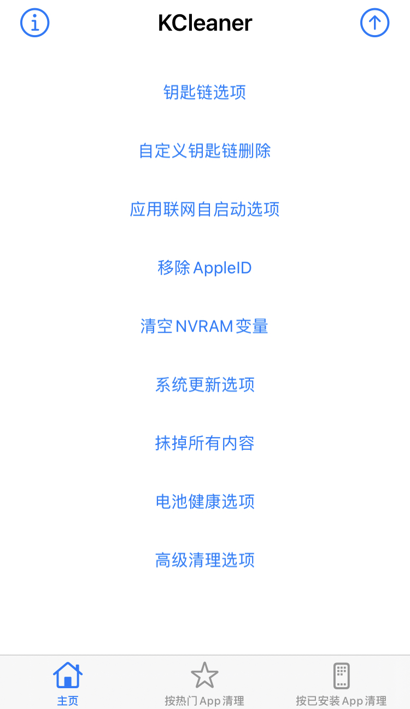
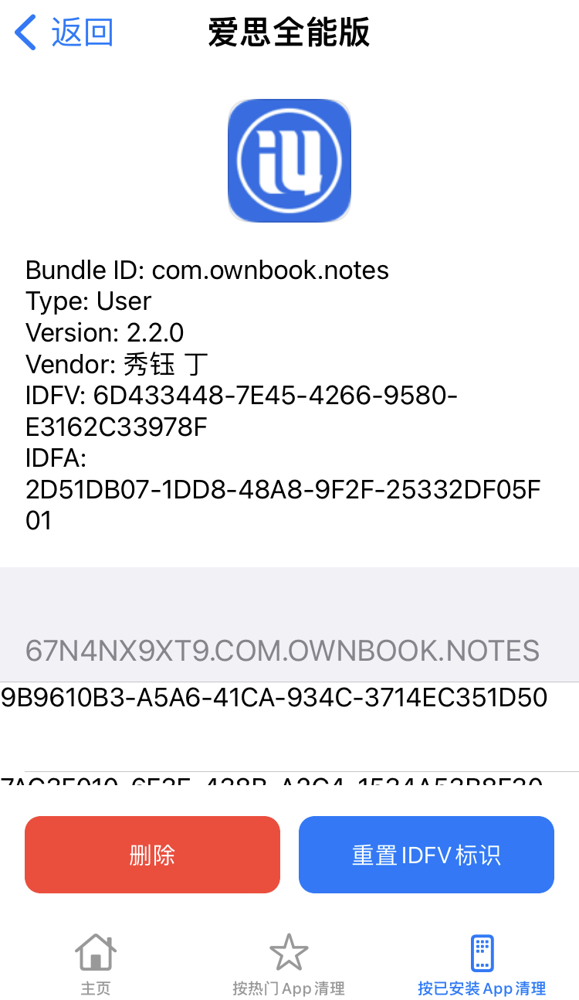
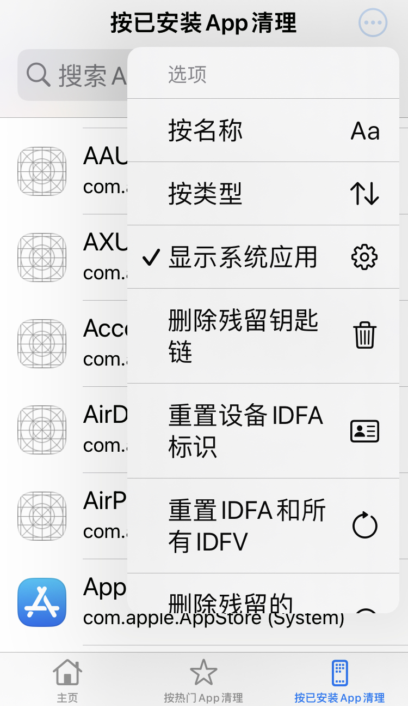

# 🔑 用于 iPhone 上的 KCleaner 钥匙链（Keychain）管理工具

[English](README.md) | 简体中文

KCleaner 是一个可以管理 iOS 上 App 创建的本地钥匙串项目的工具。它可以轻松帮你创建、修改、删除、导出任何 App 创建的钥匙链项目，摆脱应用跟踪、设备被封禁问题。比 Mac 上的“钥匙串”App 更好，它可以访问本地所有的钥匙串，尽管开发者没有开启同步功能。

## 功能

- 一键清空所有钥匙链
- 根据关键词删除钥匙链中匹配的内容
- 查看和删除单独 App 创建的钥匙链
- 查看 App 创建的钥匙链项目内容
- 导出或导入 App 的钥匙串项目
- 清理已经卸载的 App 残留的钥匙链
- 屏蔽 iOS 和配件的 OTA 升级
- 任意设定电池健康度
- 清空 NVRAM 变量
- 移除已经登录的 Apple ID
- 强制恢复出厂设置
- 禁止第三方 App 注册 Hotspot Helper，防止连接 Wi-Fi 后 App 自启动
- 清理 iOS 缓存文件并阻止相关守护进程
- 重置设备广告标识符（IDFA）和 App 标识（IDFV）

## 安装

### TrollStore

在 [Releases](https://github.com/tansnote/kcc/releases) 下载最新的 `kcc.tipa` 文件并使用 TrollStore 安装。此安装包仅支持 TrollStore。

### iOS 13 越狱设备

在 [Releases](https://github.com/tansnote/kcc/releases) 下载最新的 `kcc.deb` 文件，并在 iOS 13 越狱设备上安装。此安装包仅支持 iOS 13 越狱设备。

> [!IMPORTANT]
> 如果你需要解决设备封禁问题，仅清空钥匙串内容和 App 数据是没有用的。你还需要卸载 App 本体，然后重启一次设备。这个操作可以解决大部分问题，因为设备指纹的实现不只有这一种方法。

> [!NOTE]
> 如果开启了 iCloud 钥匙串同步，请先将其关闭，防止云端内容被重新下载到本地。

## App 预览

## 联系我

微信公众号：`Tansnotes`

## 星星统计

